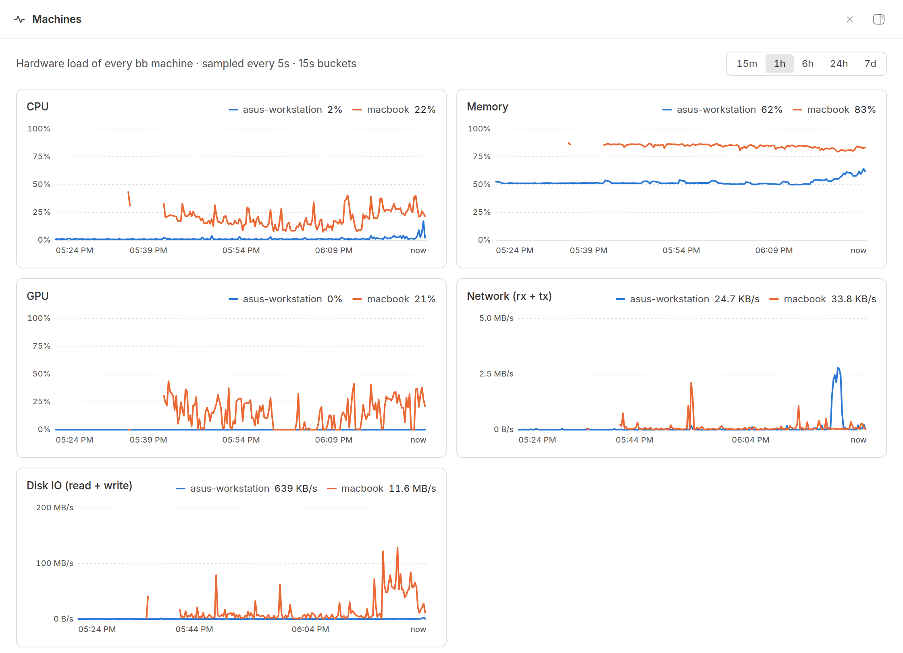
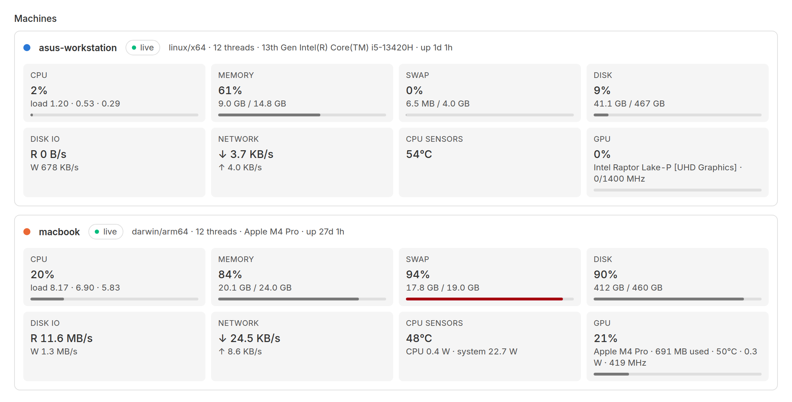

# Machine Load — hardware monitor for every bb machine

**Machine Load** is a [bb](https://getbb.app) plugin that shows the CPU, memory,
GPU, network and disk IO load of **all machines enrolled in bb on one shared
timeline**. Compare your laptop, workstation and remote servers side by side,
scroll back through 7 days of history, and let agents check load from the CLI
before they start a heavy build.



## Features

- **One timeline for all machines.** CPU %, memory %, GPU %, network
  throughput and disk IO of every bb machine drawn on the same charts, one
  color per machine, with a crosshair tooltip comparing them at any moment.
- **History from 15 minutes to 7 days.** Samples every 5 seconds, stored in
  the plugin's local SQLite database and downsampled for long ranges.
- **Per-machine cards.** CPU and load average, RAM, swap, disk usage, disk
  read/write, network ↓/↑, CPU temperature and power, and every GPU with
  utilization, memory, temperature, power and frequency.
- **GPU support without root.** NVIDIA (`nvidia-smi`), AMD (sysfs), Intel
  integrated graphics (i915/xe per-process DRM counters) and Apple silicon
  (IOAccelerator).
- **Apple silicon sensors.** CPU/GPU temperature, CPU/GPU/system power and GPU
  frequency when [`macmon`](https://github.com/vladkens/macmon) is installed
  (`brew install macmon`) — no sudo needed.
- **Sidebar alert badge** when any machine goes above 80% CPU or RAM.
- **CLI for agents and scripts:** `bb machine-load` and `bb machine-load --json`.



## Install

```sh
bb plugin install https://github.com/artgas1/bb-plugin-machine-load.git
```

Or find **Machine Load** in bb → Plugins. Open the **Machines** page in the
sidebar; new machines appear automatically once they are enrolled in bb.

## Supported platforms

| Metric | Linux | macOS | Windows (untested) |
| --- | --- | --- | --- |
| CPU %, load average, memory, disk usage | ✓ | ✓ | CPU, memory, disk |
| Swap, disk IO, network | ✓ | ✓ | — |
| CPU temperature | ✓ (hwmon) | with `macmon` | — |
| GPU utilization | NVIDIA, AMD, Intel | Apple silicon | NVIDIA |

Everything is read from the operating system without root: `/proc` and `/sys`
on Linux; `vm_stat`, `sysctl`, `netstat` and `ioreg` on macOS. Intel GPU load
counts the processes of the user running bb, which covers a desktop session.

## Settings

```sh
bb plugin config machine-load set intervalSec 5        # 2–300 seconds
bb plugin config machine-load set retentionHours 168   # 1–720 hours
```

## How it works

A small worker runs inside the bb daemon on each machine and returns one
snapshot per call. The bb server polls every connected machine, stores a
compact row per sample in the plugin's SQLite database, and pushes a realtime
signal so open pages refresh. No data leaves your machines and no account or
external service is needed.

## Development

```sh
npm install
bb plugin install .   # registers this directory
bb plugin dev         # rebuild and reload on save
```

`host.ts` collects metrics, `server.ts` polls and stores history, `app.tsx`
draws the page, `contract.ts` holds the shared schemas.

## License

[MIT](LICENSE)
